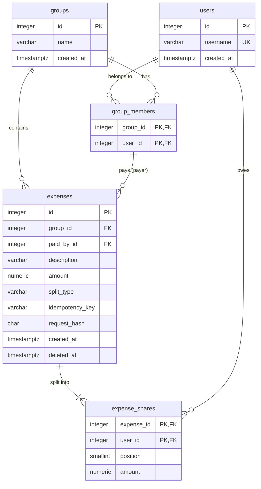

# Database Schema

**Status:** Implemented in `backend/app/models.py` and the Alembic migrations
`3055c903b988` (schema) and `da8d57b826a7` (seed).

This document describes the PostgreSQL 16 schema for SplitBill and the seed data
required by the brief.

## Design Principles

- **Money is exact.** Every monetary column is `NUMERIC(12,2)` and maps to Python
  `Decimal`. No `float` or `REAL` columns.
- **The database enforces what it can.** Keys, foreign keys, unique and check
  constraints back up the validation done in the application.
- **Expenses are immutable.** Rows in `expenses` and `expense_shares` are never updated,
  except for setting `expenses.deleted_at` on soft deletion.
- **Balances are derived, not stored.** They are computed from expenses and shares on
  each request, so they cannot drift out of sync.

## Contents

- [Identifiers](#identifiers)
- [Tables](#tables)
- [Rules Enforced Outside the Schema](#rules-enforced-outside-the-schema)
- [Balance Calculation](#balance-calculation)
- [Seed Data](#seed-data)
- [Required Test Coverage](#required-test-coverage)
- [Resolved Decisions](#resolved-decisions)

## Entity Relationship Diagram



## Identifiers

**Decision:** Entity tables (`users`, `groups`, `expenses`) use integer surrogate keys:
`id INTEGER GENERATED BY DEFAULT AS IDENTITY`. Association tables (`group_members`,
`expense_shares`) use composite primary keys and have no `id` column.

**Rationale:**

- **Matches the brief.** The brief refers to groups by integer ID (`/groups/1`, "alice
  for group 2"), so the seed data and examples work as written.
- **Simplicity.** Integer IDs are easy to read in URLs, logs, Swagger UI and tests.
- **`BY DEFAULT`, not `ALWAYS`,** so the seed migration can insert groups 1 and 2 with
  explicit IDs.
- **Composite keys for association tables.** A surrogate `id` would still need
  `UNIQUE (group_id, user_id)` to prevent duplicates, and no API refers to these rows by
  ID.
- **`username` is not the primary key.** The API identifies users by username, but
  foreign keys use `users.id`, so a username can change without touching other tables.

**Alternative considered: UUIDv7.** UUIDs hide record counts, cannot be guessed and
allow client-side generation. None of these is needed here: access control is enforced
by checking group membership on every request, not by making IDs hard to guess. UUIDs
would also diverge from the brief's integer group IDs. If UUIDs are adopted later, use
UUIDv7 (time-ordered, index-friendly), generated in Python with `uuid.uuid7()`, because
PostgreSQL 16 has no built-in v7 generator.

**Trade-off:** IDs are sequential, so they reveal approximate record counts. `INTEGER`
allows about 2.1 billion rows per table, which is sufficient for this project.

## Tables

All timestamps are `TIMESTAMPTZ` stored in UTC.

### `users`

| Column | Type | Constraints |
| --- | --- | --- |
| `id` | `INTEGER` | Primary key |
| `username` | `VARCHAR(50)` | `NOT NULL`, `UNIQUE` |
| `created_at` | `TIMESTAMPTZ` | `NOT NULL`, default `now()` |

`username` is the value sent in the `X-User` header and in `paid_by` and split member
lists. The API exposes usernames; internal integer IDs are used for foreign keys.

### `groups`

| Column | Type | Constraints |
| --- | --- | --- |
| `id` | `INTEGER` | Primary key |
| `name` | `VARCHAR(100)` | `NOT NULL` |
| `created_at` | `TIMESTAMPTZ` | `NOT NULL`, default `now()` |

### `group_members`

| Column | Type | Constraints |
| --- | --- | --- |
| `group_id` | `INTEGER` | `NOT NULL`, FK → `groups.id` |
| `user_id` | `INTEGER` | `NOT NULL`, FK → `users.id` |

- Primary key `(group_id, user_id)`: a user belongs to a group at most once.
- Index on `user_id`, for `GET /groups` (groups of the requesting user).

### `expenses`

| Column | Type | Constraints |
| --- | --- | --- |
| `id` | `INTEGER` | Primary key |
| `group_id` | `INTEGER` | `NOT NULL`, FK → `groups.id` |
| `paid_by_id` | `INTEGER` | `NOT NULL` |
| `description` | `VARCHAR(255)` | `NOT NULL` |
| `amount` | `NUMERIC(12,2)` | `NOT NULL`, `CHECK (amount > 0)` |
| `split_type` | `VARCHAR(10)` | `NOT NULL`, `CHECK (split_type IN ('equal', 'exact'))` |
| `idempotency_key` | `VARCHAR(255)` | `NOT NULL` |
| `request_hash` | `CHAR(64)` | `NOT NULL`; SHA-256 hex digest of the canonical request |
| `created_at` | `TIMESTAMPTZ` | `NOT NULL`, default `now()` |
| `deleted_at` | `TIMESTAMPTZ` | Nullable; set on soft deletion |

- **Payer must be a group member:** composite FK `(group_id, paid_by_id)` →
  `group_members (group_id, user_id)`.
- **Idempotency:** `UNIQUE (group_id, idempotency_key)`. Two concurrent requests with the
  same key cannot both insert; the second fails on the constraint and the application
  returns the existing expense.
- **The key is required.** `POST /groups/{group_id}/expenses` without an
  `Idempotency-Key` header is rejected, so duplicate protection always applies. The
  frontend generates one key per submission with `crypto.randomUUID()` and reuses it
  when retrying the same submission.
- **Same key, different request.** `request_hash` identifies the request that created
  the expense. When a key is repeated in the same group:
  - same hash: the original expense is returned and nothing is created;
  - different hash: the request is rejected with `422 Unprocessable Content`, so a
    client bug that reuses a key cannot silently drop a different expense.
- **What is hashed.** The hash covers the validated request, not the raw body, so
  formatting differences do not matter but meaningful differences do:
  - `description`, `paid_by` and `split.type`;
  - `amount` normalized to two decimal places (`"1000.0"` and `"1000.00"` are equal);
  - split members **in the order given**, with each share normalized to two decimal
    places for exact splits. Order is part of the request because it decides who
    receives the remainder satang.

  The values are serialized as canonical JSON (sorted object keys, no insignificant
  whitespace) and hashed with SHA-256. `X-User` is not included, because any group
  member may record or retry an expense.
- **Concurrent requests.** If two requests with the same key arrive together, one insert
  succeeds and the other fails on the unique constraint. The failed transaction is
  rolled back, the existing row is read, and its `request_hash` is compared as above.
- **Listing:** index on `(group_id, created_at)`. Reverse chronological order is
  `ORDER BY created_at DESC, id DESC`; `id` breaks ties between rows with the same
  timestamp.
- **Soft deletion:** `deleted_at IS NOT NULL` marks a deleted expense. The row and its
  shares are retained and excluded from balances and listings.

### `expense_shares`

| Column | Type | Constraints |
| --- | --- | --- |
| `expense_id` | `INTEGER` | `NOT NULL`, FK → `expenses.id` |
| `user_id` | `INTEGER` | `NOT NULL`, FK → `users.id` |
| `position` | `SMALLINT` | `NOT NULL`, `CHECK (position >= 0)` |
| `amount` | `NUMERIC(12,2)` | `NOT NULL`, `CHECK (amount >= 0)` |

- Primary key `(expense_id, user_id)`: a member appears in a split at most once.
- `UNIQUE (expense_id, position)`: each position is used once per expense.
- **`position` is meaningful.** It records the order in which members were listed in the
  request, starting at 0: the `members` array for equal splits, and the key order of the
  `shares` object for exact splits. For equal splits this order decides who receives the
  remainder satang, so it is stored and shares are always returned
  `ORDER BY position`. Without it, rows have no inherent order and a member who received
  an extra satang could appear in a different place than the one entered.
- `amount >= 0` rather than `> 0`, because an equal split can produce zero shares, for
  example `0.01` split among three members gives `0.01`, `0.00`, `0.00`.

Shares are stored for both split types. For equal splits they hold the computed result,
including the allocated remainder satang, so balances never need to recompute splits.

## Rules Enforced Outside the Schema

These rules are enforced by the application before the expense is saved, or before it is
deleted, and are covered by tests:

| Rule | Why not a database constraint |
| --- | --- |
| Shares sum exactly to `expenses.amount` | A check across rows needs a deferred trigger; kept in application code for simplicity |
| Every share member belongs to the group | Would require duplicating `group_id` in `expense_shares` for a composite FK |
| At most 2 decimal places | **The database cannot enforce this.** PostgreSQL silently rounds a value such as `10.005` to `10.01` when storing it in `NUMERIC(12,2)`. Validation at the API boundary is the only safeguard and must reject the value before it reaches the database |
| Amount ≤ `9,999,999,999.99` | The database would reject it with an overflow error; validating at the API boundary returns a descriptive error instead |
| Only the payer may delete | Depends on the requesting user, which the database does not know |

## Balance Calculation

For each member of a group, considering only expenses with `deleted_at IS NULL`:

```text
balance = (sum of amounts the member paid) − (sum of the member's shares)
```

A positive balance means the member is owed money. Because each expense's shares sum to
its amount, the balances of a group always sum to exactly `0.00`. Paid amounts and shares
are read in one SQL statement, so an expense recorded at the same moment cannot be counted
on only one side.

## Seed Data

Provided as an Alembic data migration that runs after the schema migration, so a single
`uv run alembic upgrade head` produces a ready-to-use database.

**Users:** `alice`, `bob`, `carol`, `dan`

**Groups:**

| `id` | `name` | Members |
| --- | --- | --- |
| 1 | Chiang Mai trip | alice, bob, carol |
| 2 | Office lunch | bob, dan |

Group IDs are inserted explicitly to match the brief, then the identity sequence is
advanced past the highest ID so later inserts do not collide. The downgrade removes the
seeded rows.

## Conventions

- Constraint names follow a SQLAlchemy `MetaData` naming convention (for example
  `pk_users`, `fk_expenses_group_id_groups`, `uq_expenses_group_id_idempotency_key`), so Alembic
  migrations are deterministic and constraints can be referenced by name.
- Foreign keys use the default `NO ACTION` on delete. Users, groups and expenses are
  never hard-deleted by the application.

## Required Test Coverage

How each test required by the brief relates to this schema:

| Required test | Schema support | Enforced by |
| --- | --- | --- |
| Equal split of `100.00` among three gives `33.34`, `33.33`, `33.33`; balances sum to `0.00` | `expense_shares.amount` and `position` store the exact allocation; balance formula above | Service (remainder allocation), database (exact storage) |
| Exact split not summing to the amount is rejected | None | Service |
| Amount with 3 decimal places is rejected | None; the database would round it silently | API validation |
| Repeated `Idempotency-Key` creates only one expense | `UNIQUE (group_id, idempotency_key)` | Database, including concurrent requests |
| `alice` can neither read nor write group 2 | `group_members` | Access check, using the `X-User` header |
| Only the payer can delete an expense | `expenses.paid_by_id`, `deleted_at` | Service, using the `X-User` header |

Additional test, not required by the brief but needed for the chosen design:

| Test | Schema support | Enforced by |
| --- | --- | --- |
| Reusing an `Idempotency-Key` with a different request returns `422` and creates nothing | `expenses.request_hash` | Service |

In the deletion test, `alice` records an expense paid by `bob`. The test shows that the
recorder cannot delete it and the payer can, which detects a regression that checks the
wrong user.

## Resolved Decisions

Also recorded under Assumptions in the README:

- **`Idempotency-Key` is required.** The brief's example always sends it but does not
  state that it is mandatory. Making it required guarantees duplicate protection for
  every expense; see [`expenses`](#expenses).
- **Any group member may record an expense paid by any other member.** The requester
  (`X-User`) and the payer (`paid_by`) may differ; the only requirement is that both
  belong to the group. This follows the brief, whose frontend form includes a payer
  field separate from the selected user. The requester is not stored, so there is no
  `created_by_id` column. Deletion remains restricted to the payer, so a member who
  records an expense on behalf of someone else cannot delete it.
- **A repeated key with a different request is rejected.** The brief states that a
  repeated key returns the original expense, but does not cover a different request
  body. Returning the original in that case would hide a client bug and silently drop
  the second expense, so it is rejected with `422`. A repeated key with the same request
  still returns the original expense, as the brief requires. This follows the IETF
  `Idempotency-Key` header draft and Stripe's behavior. See [`expenses`](#expenses).
